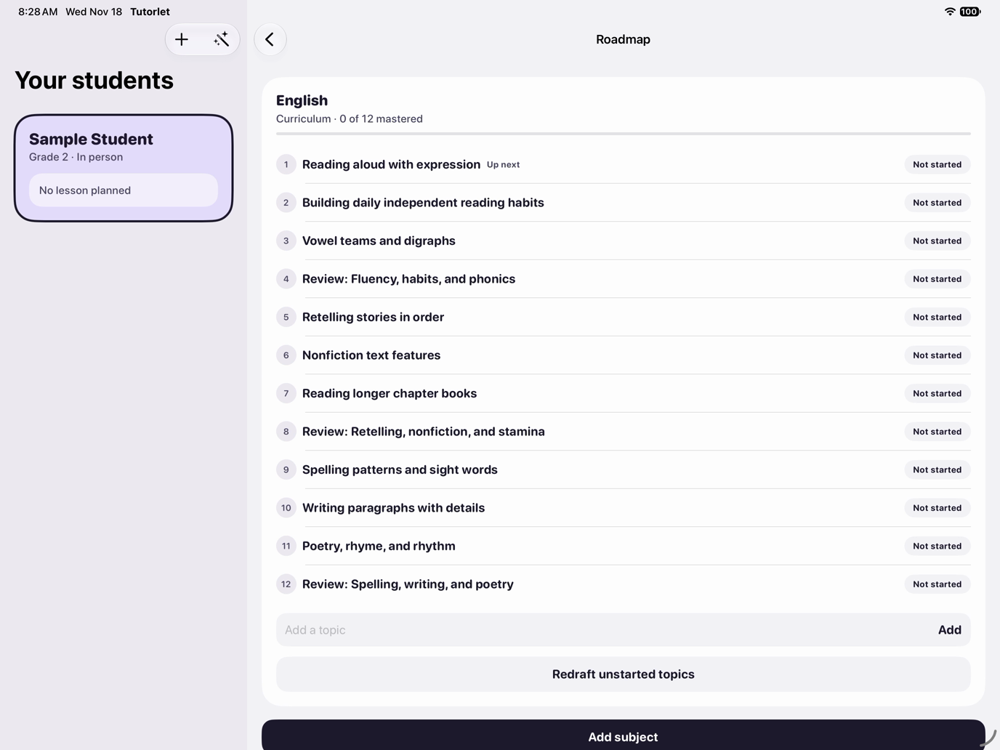
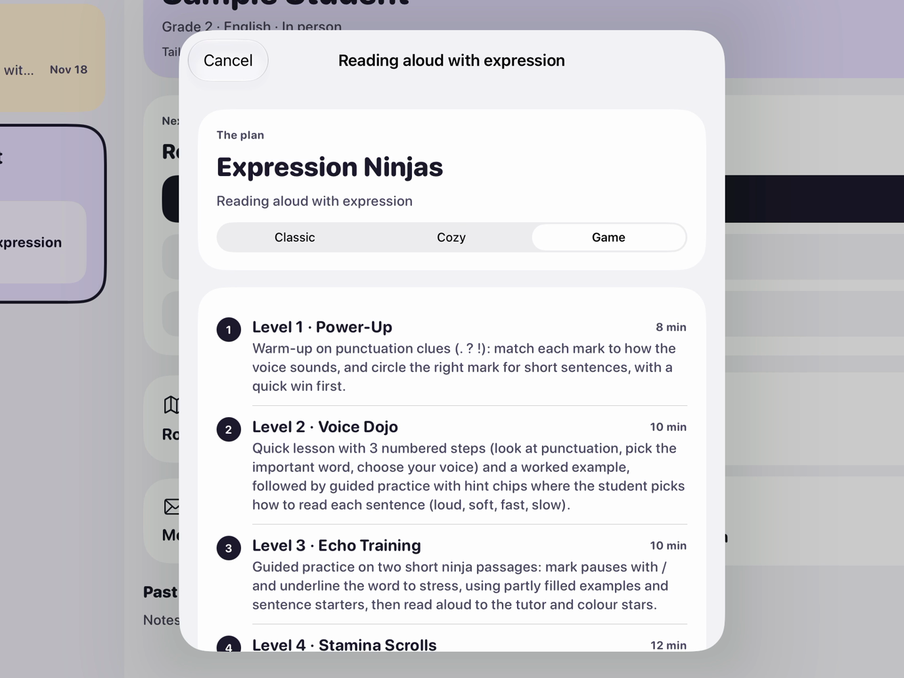
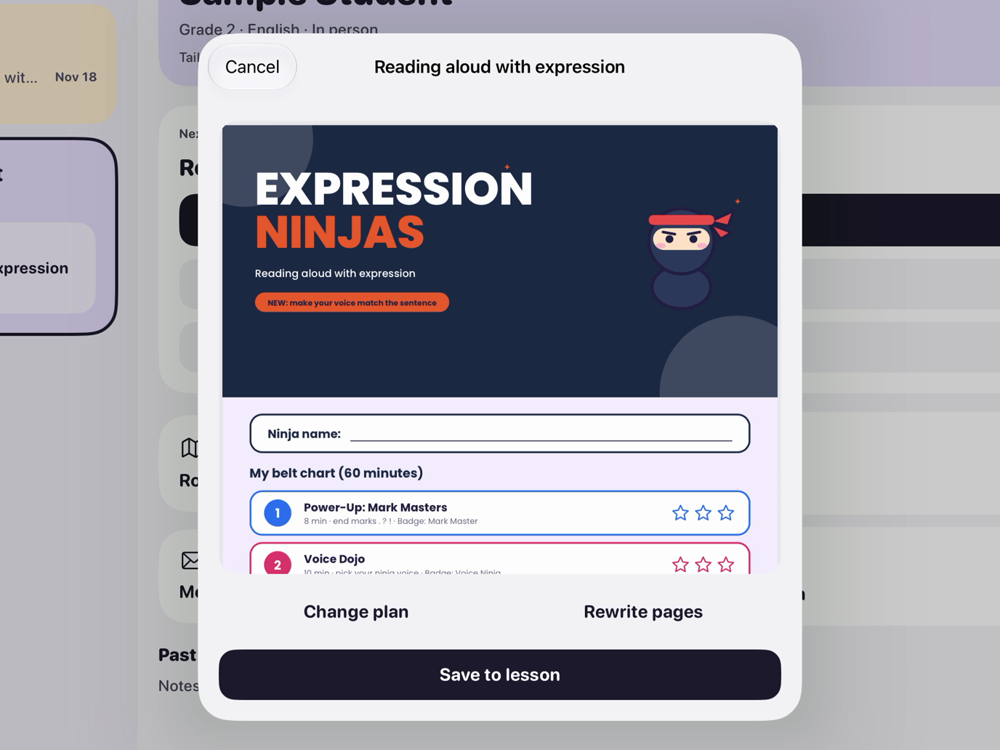
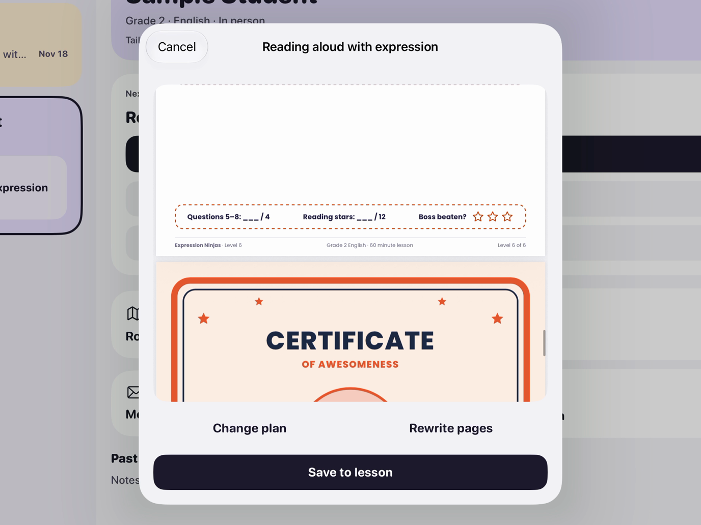

# Tutorlet

**AI lesson planning for private tutors.** Tutorlet is an iPad, iPhone and Mac app that keeps each student's profile, curriculum roadmap and lesson notes in one place, and turns the next lesson into a tailored, print-ready worksheet pack.

▶️ **[Watch the 77-second demo](YOUTUBE_LINK)**

<p>
  
  
</p>
<p>
  
  
</p>

## Why I built it

I've tutored 25+ students from Grade 1 to Grade 11 over five years. The best lessons were the ones tailored to the student: a competitive kid gets timed "levels" and a boss round, a student who gets anxious gets calm, untimed pages. Making those materials by hand took hours every week. Tutorlet does the tailoring once, in the student's profile, and reuses it for every lesson.

## What it does

- **Student profiles:** grade, subjects, strengths, focus areas, interests and learning style, entered once. Regular weekly lesson times are set here too.
- **Roadmaps:** a curriculum or goal per subject. The AI drafts topics in teaching order with review checkpoints, and the tutor can redraft or add topics as the student progresses. Topic status updates from each lesson's rating.
- **Lesson planning:** suggests the next roadmap topic, plus an optional focus such as "test on Friday, pages 112–130".
- **AI worksheet packs:** see below. Three styles (Classic, Cozy, Game), with mascots and a certificate for younger students.
- **Lesson notes and monthly reports:** quick notes after each lesson, and a professional PDF report for parents built from the notes the tutor chooses to share.

## How worksheet generation works

1. **Plan first.** The app sends Claude the student's profile and the lesson details and gets back a lesson plan as JSON: title, theme, colour palette, and each part with its minutes and purpose. The tutor reviews it, asks for changes in plain words, or switches style before any pages are written.
2. **Parts written in parallel.** The cover, certificate and each part are requested at the same time with a Swift task group, so a full pack takes about a minute instead of several. Replies are filed by part number, so pages always come back in order.
3. **A design system, not free-form HTML.** Claude writes pages using only the classes in a hand-built CSS design system, with mascot placeholders the app swaps for consistent SVG drawings. The app strips any inline styles outside an allow-list, so the AI controls the content and the CSS controls the look.
4. **Pages that fit.** The pages are laid out in an off-screen `WKWebView`. JavaScript measures each one, and any page that runs past the bottom is sent back to be shortened, up to two rounds.
5. **PDF.** Each page is captured at US Letter size and merged with PDFKit into one file, which is saved to the lesson and can be printed or shared.

**Privacy:** student names are never sent to the AI. Requests are built without the name field, and any name a tutor types into a note is replaced with "the student" before sending.

## Tech

- **SwiftUI** with an adaptive layout: a sidebar of student cards on iPad and Mac, and navigation on iPhone
- **SwiftData** for students, lessons, roadmaps, topics and worksheets
- **Claude API** (Messages API, structured JSON replies) over `URLSession` with async/await
- **Swift concurrency:** task groups for parallel generation, `@MainActor` for UI-bound work
- **WebKit** and **PDFKit** for HTML-to-PDF rendering; `ImageRenderer` for the monthly report
- **Codable** models for every AI reply

## Project structure

| Area | Files |
| --- | --- |
| Models | `Student`, `Lesson`, `Track`, `Topic`, `Worksheet` |
| Screens | `ContentView`, `StudentDetailView`, `SubjectsView` (roadmaps), `PlanLessonView`, `EditLessonView`, `ReportView`, `GenerateWorksheetView` |
| AI and rendering | `ClaudeClient`, `WorksheetGenerator`, `WorksheetRenderer` |
| Worksheet design system | `game.css`, `cozy.css`, `classic.css`, `mascots.json`, `style-guides.json`, `system-prompt.txt` |

## Running it

1. Open `TutorShelf.xcodeproj` in Xcode and choose an iPad simulator.
2. Create `TutorShelf/Secrets.swift` (it's in `.gitignore` and never committed):

   ```swift
   enum Secrets {
       static let anthropicKey = "YOUR_ANTHROPIC_API_KEY"
   }
   ```

3. Run. Tap the wand button on the student list to add a sample student with a roadmap.

## What's next

- Slides for online lessons, from the same packs
- iCloud sync between iPad and Mac
- Redo a single page of a pack

---

Built by **Yulicia Kwok**, first-year Business and Computer Science at UBC · [github.com/yuliciakwk](https://github.com/yuliciakwk)
